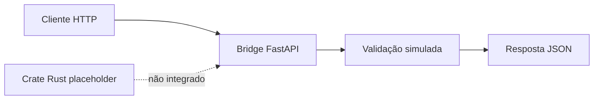

 | [](LICENSE) | [](https://github.com/sponsors/felipetjmg1-bit)

<p align="center"></p>


# Aurora Omni Kernel — Protótipo de API

## Visão geral

Embora o README descreva uma iniciativa de soberania tecnológica com IA e blockchain, o conteúdo verificável é um protótipo pequeno: uma ponte HTTP FastAPI com validação simulada de Aurora ID baseada em formato de endereço TON, mais esqueletos não implementados para um core Rust e funções de vault. Não há evidência no código inspecionado de um kernel de sistema operacional funcional, integração real com TON, IA operacional ou criptografia implementada.

## Objetivo e valor

**Problema/escopo:** Protótipo de ponte FastAPI para validação simulada de Aurora ID, com componentes iniciais em Python e Rust.

**Valor verificável hoje:** o repositório torna explícitos seus artefatos, interfaces e limitações para que mantenedores e contribuidores possam avaliar o que existe sem confundir demonstração, proposta e produção.

## Arquitetura e tecnologias

Não documentada formalmente. A árvore sugere bridge FastAPI, módulo de integração TON, módulo vault e crate Rust em core; isso é somente uma leitura da organização dos arquivos, não uma arquitetura descrita ou demonstrada como sistema integrado.



- Python (linguagem principal reportada pelo GitHub); FastAPI e Uvicorn, fixados em requirements.txt; Pydantic é importado no código, mas não consta diretamente nesse arquivo de dependências.
- Rust 2021 com crate aurora-omni-kernel versão 0.1.0-alpha; Cargo.toml não declara dependências e core/src/lib.rs contém apenas um comentário de placeholder.
- Integração TON nominal em blockchain/ton_integration.py; o próprio código marca chamadas à API e validação como simulações/placeholders.
- A API de linguagens do GitHub reporta Python e Rust.

## Início rápido

Os comandos abaixo refletem instruções, manifestos ou pontos de entrada presentes no repositório. Dependências externas, segredos e serviços estão indicados quando aplicável; a presença de um comando não equivale a uma execução validada.

1. O README não fornece comandos. Com base nos arquivos públicos: `python -m pip install -r requirements.txt` instala as dependências listadas (FastAPI 0.109.0 e Uvicorn 0.27.0).
2. Com base no bloco `__main__` de bridge/main.py: `python bridge/main.py` inicia Uvicorn em 0.0.0.0:8001. Estes comandos foram inferidos dos manifestos/código, não executados na revisão estática do repositório; o repositório não apresenta procedimento de instalação formal nem dependências de teste.
3. Não há comando comprovado para build/execução de kernel Rust: o crate só contém um placeholder de biblioteca e não define binário ou funcionalidade executável visível.


## Exemplo de uso

Com o servidor FastAPI executando na porta 8001, as rotas observáveis incluem:

```bash
curl http://localhost:8001/
curl -X POST http://localhost:8001/validate-id \
  -H 'Content-Type: application/json' \
  -d '{"wallet_address":"UQAZLd4Qeonhs9wgj1JDvuA1MbQsmMWbkQg_BGPvoj099D1K"}'
curl http://localhost:8001/kernel/status
```

A validação é simulada por formato e não consulta a rede TON; o endpoint de status retorna valores fixos.

## Estado e limitações

**Maturidade indicada:** Protótipo.

- A classe AuroraTONConnector não consulta toncenter: valida apenas prefixo/comprimento e cria identificador local derivado por SHA-256; saldo é retornado como 1000.0 fixo.
- GET `/kernel/status` retorna valores literais, inclusive `uptime: 99.99%`; não representa telemetria verificada.
- vault/crypto.py declara encrypt_data e decrypt_data com `pass`; o comentário AES-256-GCM é placeholder, não implementação.
- core/src/lib.rs é somente comentário de placeholder; não há engine neural ou kernel implementado visível.

## Contribuição

Leia [CONTRIBUTING.md](CONTRIBUTING.md) antes de abrir uma issue ou pull request. Para reportes de segurança, siga a orientação específica do repositório, se houver.

## Licença

Este repositório está licenciado sob **MIT**; consulte [LICENSE](LICENSE).

## Patrocínio e apoio

O desenvolvimento aberto exige tempo para manutenção, documentação, testes, revisão de contribuições e resposta a issues. Se este projeto for útil, considere apoiar a continuidade pelo [GitHub Sponsors](https://github.com/sponsors/felipetjmg1-bit). O apoio não representa promessa de funcionalidades, prazo de entrega ou suporte comercial.

[](https://github.com/sponsors/felipetjmg1-bit)


**Empresa responsável:** Impulso Digital Soluções em IA.
